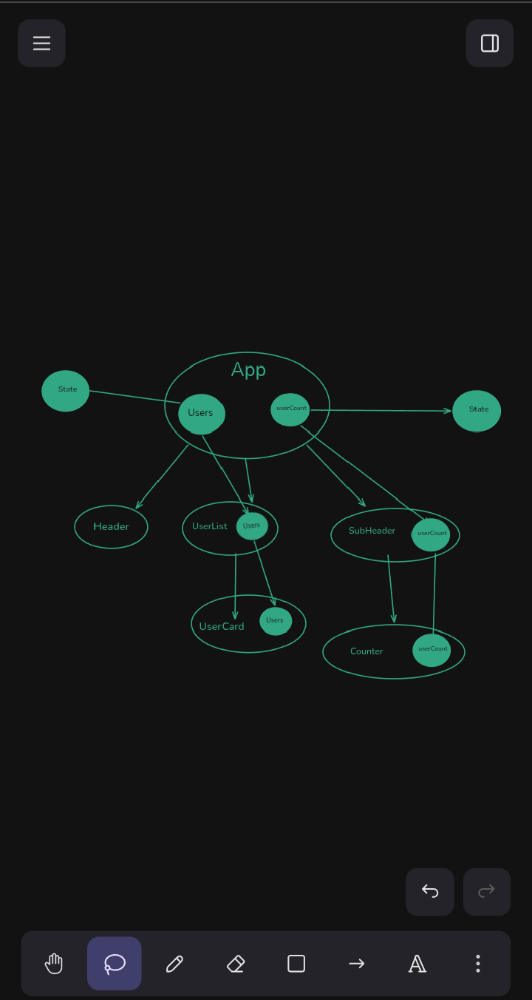
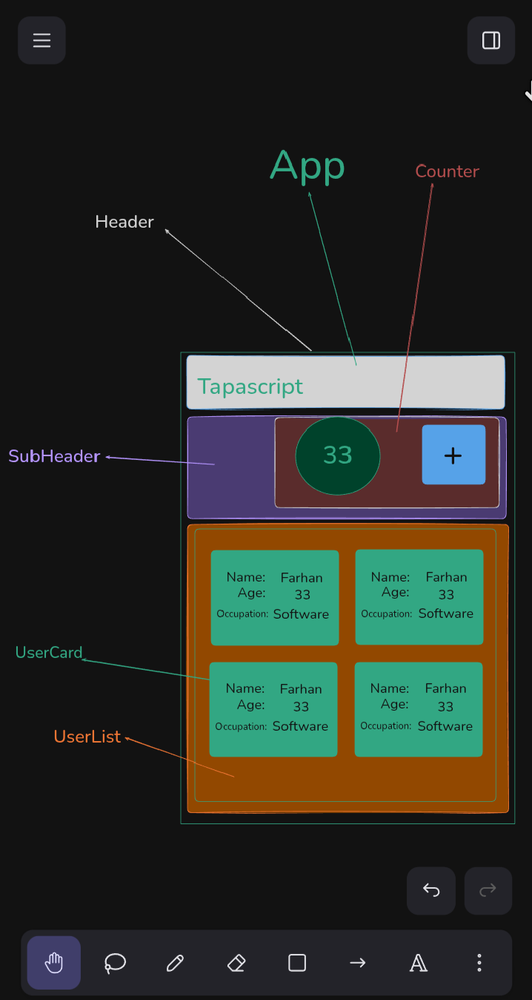

## Explanation of this project

This project is a small React application built with Vite and Tailwind CSS to practice component-based UI development and React state management.

The app displays a list of user cards showing each person's name, age, and occupation. The main screen is composed of a few reusable components:
- `Header` displays the app branding.
- `SubHeader` wraps the counter section.
- `Counter` shows the current user count and includes a button to add a new user.
- `UserList` renders all user cards.
- `UserCard` displays a single user's information.

The app demonstrates how data can be passed from a parent component to child components using props, and how a button click can update the UI by changing React state. When the user clicks the `+` button, the app increments the count and adds a randomly selected mock user to the list.

Tech used:
- React
- Vite
- Tailwind CSS

## How to run this project
```sh
npm i
npm run dev
```

## UI Diagram


## Component Hierarchy diagram


## Component Breakdown


## app link
[App link]()
