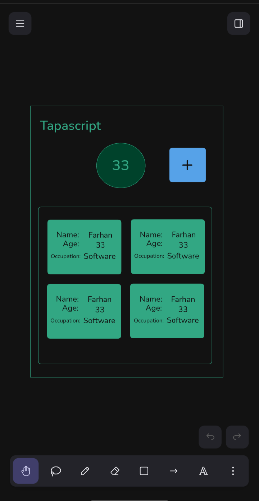
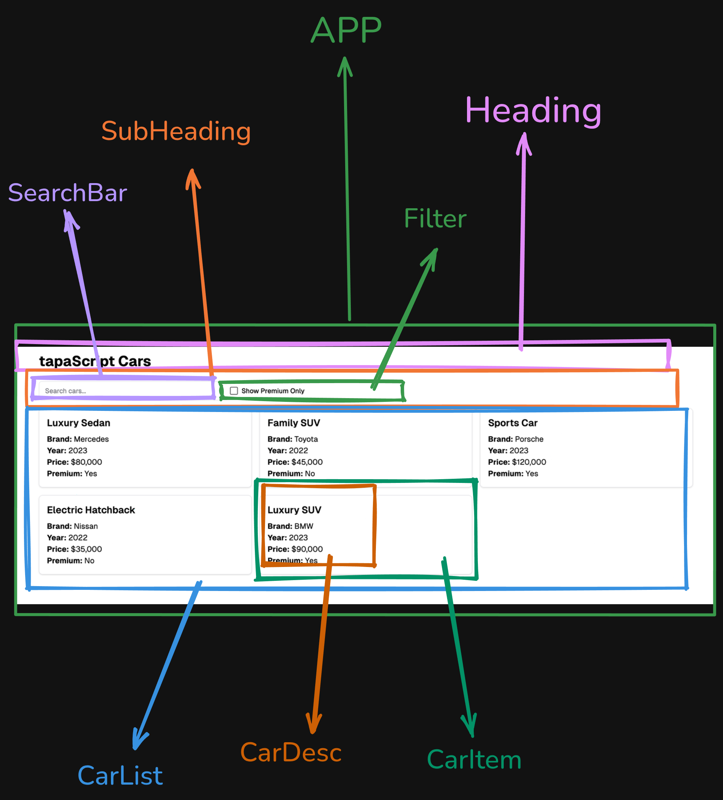
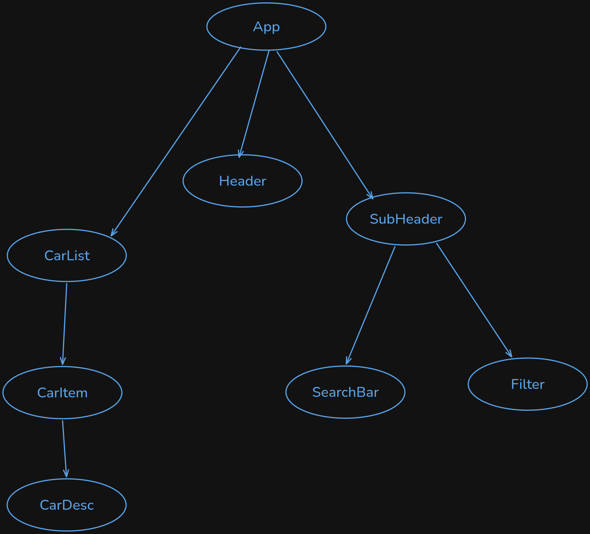

## Explanation of this project

This is a small React practice project, probably from a “15 days of React” learning challenge.

In simple words:
- It builds a simple car listing page.
- The page has:
  - a title: “TapaScript Cars”
  - a search box
  - a checkbox for “Show premium only”
  - a grid of car cards
- Each car card shows:
  - title
  - brand
  - year
  - price
  - whether it is premium or not

What the code is doing:
- App.jsx puts the whole page together
- Header.jsx creates the page title
- SubHeader.jsx holds the search and filter UI
- SearchBar.jsx and Filter.jsx are the input controls
- CarList.jsx contains the list of cars
- CarItem.jsx and CarDesc.jsx show each car card

Tech used:
- React
- Vite
- Tailwind CSS

## How to run this project
```sh
npm i
npm run dev
```

## UX DIAGRAM


## Component Breakdown diagram


## Component Hierarchy diagram


## React Dev Tools Screenshot


## App link
[Live App Link](https://15-days-of-react-971m.vercel.app/)
